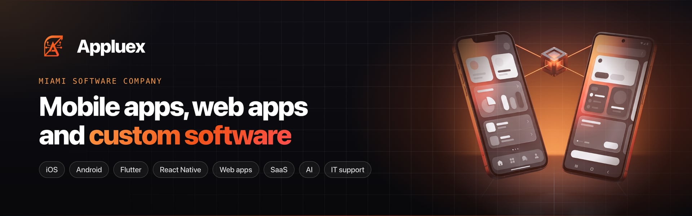
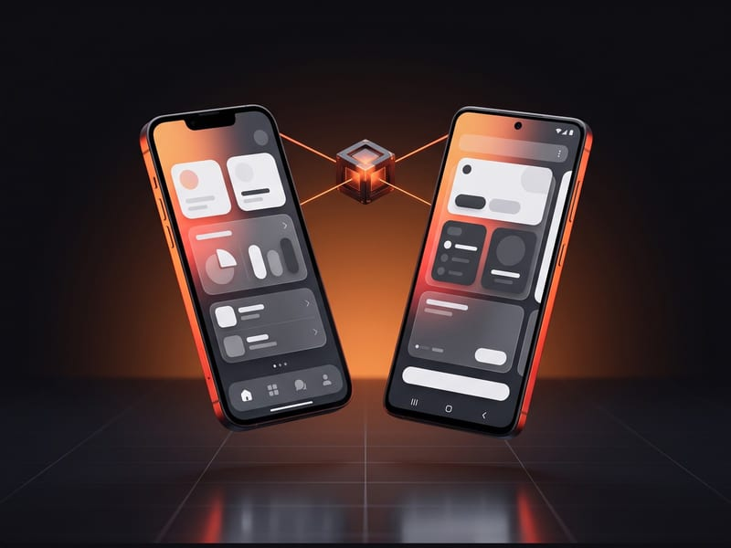
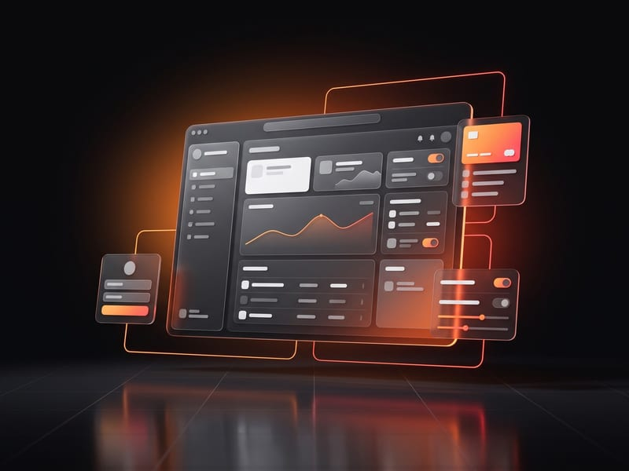
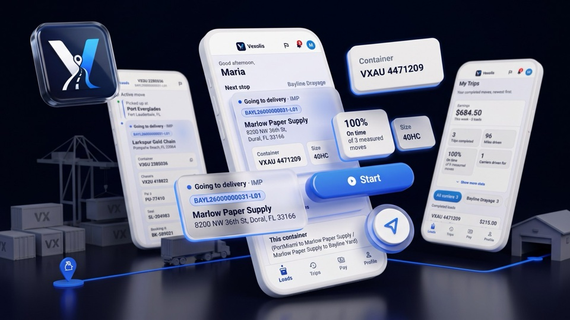
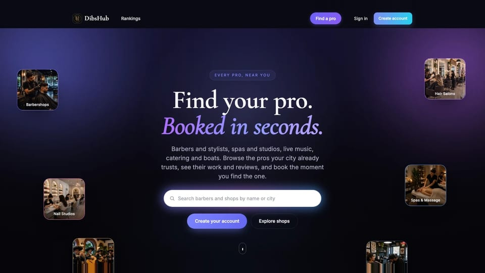
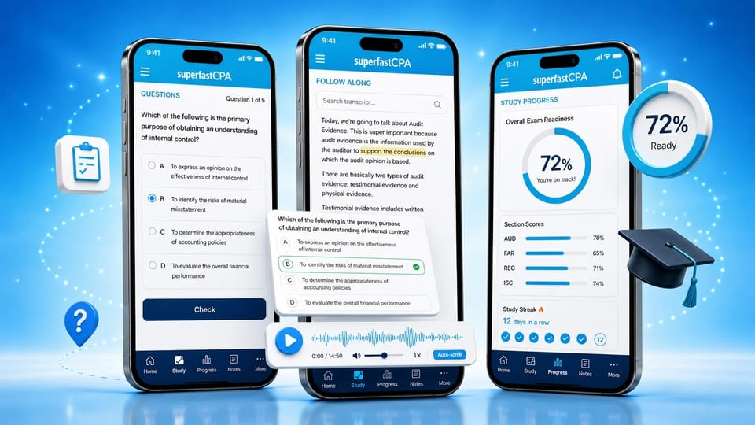
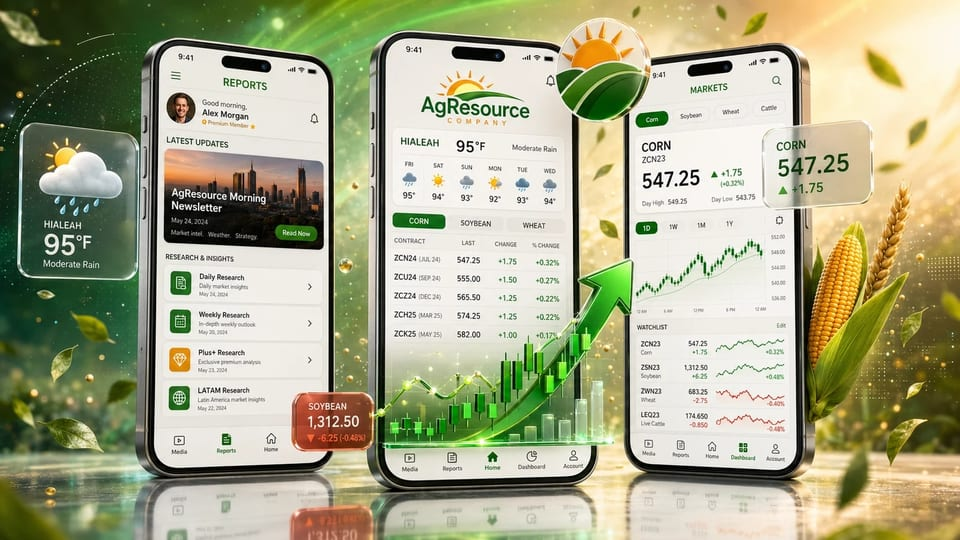
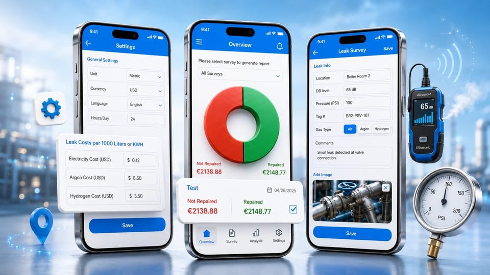
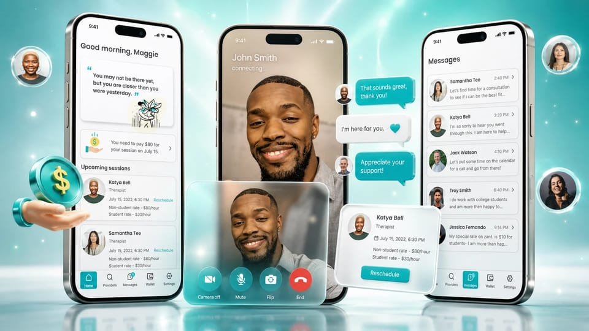

  
  
  
  
  

## We build software people actually use

Appluex is a Miami software company. We design and build mobile apps for iOS and Android, web apps, SaaS products, custom software and AI features, and we keep small businesses running with managed IT support.

Some clients come to us with an idea and need a first version. Others need a tool that finally replaces the spreadsheets, or have an app that was left half finished or built with AI tools. We take those on too: we review the code, tell you plainly what we found, and fix or finish it.

We work in English and Spanish. Most client code is private, so it does not live here; what we can show is below and at [appluex.com/portfolio](https://appluex.com/portfolio).

## What we do

<table>
<tr>
<td width="50%" valign="top">

<h3>Mobile apps</h3>
iOS and Android apps, native or cross platform with Flutter and React Native. From the first screen design to the App Store and Google Play listing.
 <a href="https://appluex.com/mobile-app-development">Mobile app development</a>
</td>
<td width="50%" valign="top">

<h3>Web apps</h3>
Dashboards, portals and internal tools that run in the browser, fast on a phone and solid behind the scenes.
 <a href="https://appluex.com/web-app-development">Web app development</a>
</td>
</tr>
<tr>
<td width="50%" valign="top">

<h3>Custom software</h3>
Software shaped around how your business already works: the tool that replaces the spreadsheets, the integrations between systems that never talked to each other.
 <a href="https://appluex.com/custom-software-development">Custom software development</a>
</td>
<td width="50%" valign="top">

<h3>SaaS products</h3>
Multi-tenant products with accounts, roles, subscriptions and billing. We run our own SaaS products too, so we build them the way we would want to operate them.
 <a href="https://appluex.com/saas-development">SaaS development</a>
</td>
</tr>
<tr>
<td width="50%" valign="top">

<h3>AI features</h3>
AI that does a real job inside your product: recommendations, document reading, assistants and search over your own data.
 <a href="https://appluex.com/ai-development">AI development</a>
</td>
<td width="50%" valign="top">

<h3>Audit and code rescue</h3>
An app that stalled, a codebase nobody wants to touch, or a prototype built with AI tools. We read it, report what we found in plain words, then fix or finish it.
 <a href="https://appluex.com/software-audit">Software audit</a>
</td>
</tr>
<tr>
<td width="50%" valign="top">

<h3>UI and UX design</h3>
Screens designed before a line of code is written, so you see and test the product early and change course cheaply.
 <a href="https://appluex.com/portfolio">See the work</a>
</td>
<td width="50%" valign="top">

<h3>Managed IT support</h3>
Computers, networks, email and backups looked after for small businesses, with a person who picks up the phone.
 <a href="https://appluex.com/it-services">IT services</a>
</td>
</tr>
</table>

## Selected work

<table>
<tr>
<td width="50%" valign="top">

<h3>Vexolis</h3>
Our own logistics SaaS: a drayage marketplace across carriers, a live fleet tracking console and a mobile app for drivers to manage loads and documents.
 Web, iOS, Android · Stripe · Postgres
 <a href="https://vexolis.com">vexolis.com</a> · <a href="https://appluex.com/portfolio/vexolis">Case study</a>
</td>
<td width="50%" valign="top">

<h3>DibsHub</h3>
Our own booking platform for independent service providers: a personal booking site, self scheduling around the clock, client profiles and automatic reminders.
 Web SaaS
 <a href="https://dibshub.com">dibshub.com</a> · <a href="https://appluex.com/portfolio/dibshub">Case study</a>
</td>
</tr>
<tr>
<td width="50%" valign="top">

<h3>SuperfastCPA</h3>
Study app for CPA exam candidates that turns proven study methods into quick review sessions they can repeat anywhere.
 iOS, Android · React Native · Node.js · MongoDB · AWS
 <a href="https://apps.apple.com/us/app/superfastcpa/id1231681537">App Store</a> · <a href="https://play.google.com/store/apps/details?id=com.superfastcpa.app2">Google Play</a> · <a href="https://appluex.com/portfolio/superfastcpa-exam-prep">Case study</a>
</td>
<td width="50%" valign="top">

<h3>AgResource</h3>
Farm market commentary and marketing advice delivered to growers in real time, through daily and weekly newsletters and Plus+ reports.
 iOS, Android · Flutter · Node.js · PostgreSQL · AWS
 <a href="https://apps.apple.com/us/app/agresource/id1545480363">App Store</a> · <a href="https://appluex.com/portfolio/agresource-market-app">Case study</a>
</td>
</tr>
<tr>
<td width="50%" valign="top">

<h3>Leak Survey Sidekick</h3>
Helps maintenance teams find and track industrial compressed air leaks, follow each repair and add up the savings.
 iOS, Android · Flutter · Node.js · PostgreSQL · AWS
 <a href="https://apps.apple.com/us/app/leak-survey-sidekick/id1616693559">App Store</a> · <a href="https://play.google.com/store/apps/details?id=com.uesystems.leaksurvey.sidekick">Google Play</a> · <a href="https://appluex.com/portfolio/leak-survey-sidekick">Case study</a>
</td>
<td width="50%" valign="top">

<h3>Zant.</h3>
Affordable access to mental health providers across many specialties, including trauma, addiction recovery and eating disorders.
 iOS, Android · Flutter · Node.js · MongoDB · Firebase · AWS
 <a href="https://appluex.com/portfolio/zant-mental-health-app">Case study</a>
</td>
</tr>
</table>

<a href="https://appluex.com/portfolio"><b>See the full portfolio</b></a>

## What we build with

## How a project starts

1. **A call.** You tell us what you need, or what is broken. No cost and no obligation.
2. **A plan in writing.** Scope, timeline and price, before any work begins.
3. **Something you can see early.** Screens and working builds you can try, not just status reports.
4. **Launch, then support.** We publish it, and we can stay on to support and grow it.

  
<a href="mailto:sales@appluex.com">sales@appluex.com</a> · <a href="tel:+17862240524">(786) 224-0524</a> · Miami, Florida

